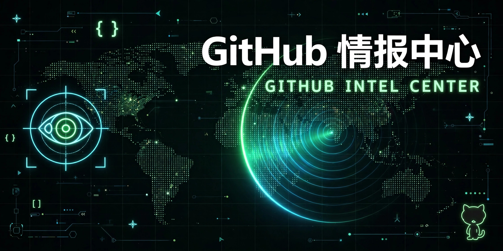

<div align="center">



# ◢ GitHub Intel Center

**ЦЕНТР РАЗВЕДКИ GITHUB**

Плановые обходы популярных репозиториев GitHub · Анализ движком правил (не ИИ) · Президентский брифинг — двойная рассылка в Telegram

[](https://github-intel-hub.u20261103.workers.dev)
[](https://github.com/u20260317/github-intel-hub/releases)
[](https://workers.cloudflare.com)
[](#возможности)

[Онлайн-панель](https://github-intel-hub.u20261103.workers.dev) · [Последний Release](https://github.com/u20260317/github-intel-hub/releases) · [Возможности](#возможности) · [Команды бота](#команды-бота-v52) · [Развёртывание](#шаги-развёртывания) · [Документация](docs/README.md)

</div>

<div align="center">

[中文](README.md) · [English](README.en.md) · **Русский** · [Українська](README.uk.md) · [日本語](README.ja.md) · [한국어](README.ko.md) · [Español](README.es.md) · [العربية](README.ar.md)

</div>

Панель в стиле «хакерского разведцентра», работающая на Cloudflare Workers: по расписанию обходит популярные репозитории GitHub, с помощью **движка правил** (не ИИ) выполняет оценку популярности и разметку точек обучения и подсказывает, какие проекты с открытым кодом сейчас стремительно растут и чему стоит научиться у каждого из них. Каждое утро «Президентский брифинг» автоматически отправляется в личные сообщения и в канал Telegram (канал распознаётся автоматически — достаточно сделать бота администратором, настройка не нужна).

Один файл `worker.js`, ноль зависимостей, данные хранятся в KV. Тёмная панель: почти чёрный фон + неоновый зелёный/циан + моноширинный шрифт + текстура сканлайнов + бегущая строка.

## Возможности

- **Одиннадцать разведывательных каналов** (в v2 добавлено 3, в v3 ещё 2; за один раунд обхода — суммарно 11 вызовов GitHub Search API, что намного ниже лимита в 50 подзапросов бесплатного тарифа)
1. `surge` Растущие звёзды: созданы за последние 30 дней, stars>50
2. `trending-week` Хиты недели: устоявшиеся популярные репозитории с пушами за последние 7 дней, stars>5000
3. `ai-agent` AI/AGENT: ключевые слова ai-agent / llm / mcp
4. `workers` Периферия/боты: cloudflare-workers / serverless / telegram-bot
5. `media` Генерация мультимедиа: comfyui / image-generation / text-to-speech
6. `devtools` Инструменты разработчика: developer-tools / browser-automation / playwright
7. `security` ИБ · красная команда · SRC: cybersecurity / red team / bug bounty / penetration-testing / vulnerability, stars>200, пуши за последние 90 дней
8. `skills` Экосистема Skill: claude-skills / agent-skills / claude-skill (токены без кавычек), stars>50, пуши за последние 90 дней
9. `creator` Полный набор для авторов: short-video / video-editing / ffmpeg / content creation / subtitles / livestream, stars>200
10. `src-hunt` SRC · поиск уязвимостей (новое в v3): bug-bounty / 漏洞挖掘 / vulnerability-scanner / vulnerability-hunting, stars>30, пуши за последние 90 дней
11. `sec-learning` Учебные материалы по ИБ (новое в v3): pentest / ctf / web-security / cybersecurity-learning / security-roadmap, stars>200, пуши за последние 90 дней
- **Урок по синтаксису запросов (проверено на практике)**: в группе OR в скобках в GitHub Search можно размещать только токены без кавычек; фраза в кавычках (например, `"claude skills"`), помещённая внутрь скобок OR, напрямую возвращает `total_count=0` (именно поэтому канал skills в v2 весь раунд был пуст). Фразы в кавычках можно использовать только отдельно, вне скобок, например `"bug bounty" tools stars:>100` (54 записи, работает нормально). Ключевые слова на китайском допустимы, например `漏洞挖掘 stars:>50` (47 записей).
- **Семена точечного мониторинга WATCHLIST**: вручную отобранный список `SEEDS` в коде — суммарно 23 записи (экосистема Skill: 12 репозиториев + 1 внешний сайт Cocoloop, письмо — 3, научные исследования — 1, авторский контент — 8, ИБ — 2), у каждой — написанная вручную одна фраза о точке обучения. На панели есть отдельный раздел «Точечный мониторинг WATCHLIST», где записи сгруппированы по категориям; если обход находит одноимённый репозиторий семени, на карточке объединяется и показывается его актуальное состояние: ★ / популярность / рейтинг / приращение за раунд; семена, не попавшие в обход, по ротации отдельно освежаются самим обходом (см. описание v5 ниже), а до тех, до которых очередь ещё не дошла, ставится пометка «точечный мониторинг».
- **Сравнение снимков**: каждый раунд число звёзд сохраняется в снимок (KV `intel:prev`), на следующем раунде вычисляется приращение каждого репозитория за раунд `starDelta`, на панели — бейдж `+N★ за раунд`, список растущих сортируется по приращению.
- **Анализ движком правил** (в коде это таблица ключевых слов `LEARNING_MAP` + взвешенная формула; на панели честно помечено «анализ по правилам»)
- Оценка популярности 0–100: масштаб звёзд 40 + приращение за раунд 30 + свежесть пушей 20 + активность форков 10
- Теги точек обучения: 40 отображений ключевых слов (в v2 добавлены: pentest/red-team → методика оценки красной команды, vulnerability → управление уязвимостями, bug-bounty → подход краудсорсингового тестирования SRC, osint → разведка по открытым источникам, skill → паттерн упаковки Skill, subtitle → инженерия субтитров, short-video → рабочий процесс коротких видео и др.)
- Рейтинг: S ≥70, A ≥45, B — остальные; к каждой записи — одна шаблонная оценка, например: «За последний раунд +320★, проект подключения по протоколу Python MCP — стоит посмотреть, как у него устроено подключение по протоколу MCP».
- **Система детализированных тегов безопасности** (новое в v3, в коде — `SECURITY_TAG_MAP`): по имени репозитория + описанию + topics выполняется ещё один проход сопоставления ключевых слов безопасности, дающий детализированные теги: SQL-инъекция / XSS / SSRF / RCE / соревнования CTF / разведка по открытым источникам OSINT / анализ вредоносного кода / цифровая криминалистика / защита синей команды / аудит кода / проникновение во внутреннюю сеть / повышение привилегий / сканирование уязвимостей / исследование PoC / разборы уязвимостей / траектория обучения / учения по защите от фишинга / обратная инженерия / фаззинг / DevSecOps и др.; они объединяются с тегами точек обучения с дедупликацией, максимум 6 на репозиторий. Короткие слова RCE/PoC сопоставляются по границам слов, чтобы «source» ошибочно не помечался как RCE, а «epoch» — как PoC; «learning» помечается как траектория обучения только в контексте безопасности, чтобы репозитории machine learning не получали метку по ошибке. Все теги — классификация, ориентированная на обучение/исследования, а не руководство по эксплуатации.
- **Взаимодействие с панелью** (обновление v2): липкая верхняя панель с реальными часами пекинского времени и статусом обхода; в KPI добавлены число каналов и число семян; липкая панель фильтров поддерживает двумерную фильтрацию по каналу + рейтингу (S/A/B) и поиск; карточки рейтингов — с рангами, анимированными полосами популярности и свечением при наведении; каждая карточка ведёт прямо на страницу репозитория на GitHub; кнопка немедленного обхода с троттлингом 30 минут.
- **Фильтрация по тегам и облако тегов** (новое в v3): тег на каждой карточке — кликабельный chip; щелчок фильтрует «Всю разведку» по этому тегу (комбинируется с каналом/рейтингом/поиском по AND), рядом с панелью фильтров — pill активного тега, снимаемый одним щелчком; над разделом ИБ — облако «популярных тегов»: по частоте тегов репозиториев трёх каналов безопасности (security/src-hunt/sec-learning) берутся первые 15, щелчок по тегу в облаке также запускает фильтрацию.
- **Пагинация «Всей разведки»** (новое в v3): сетка «Вся разведка» переведена на клиентскую пагинацию — 24 записи на страницу (в соответствии с договорённостью DEAL HUB), с кнопками «назад/вперёд» и номерами страниц (при большом числе страниц сворачивается многоточием); строка состояния показывает «Страница X / Y · всего N записей (после фильтрации)»; любое изменение фильтра/поиска/тега возвращает на страницу 1 и пересчитывает число страниц по отфильтрованному набору, а после переворота страницы вид автоматически прокручивается к началу раздела «Вся разведка». Разделы по-прежнему показывают Top-N без пагинации.

## Взаимодействие с панелью (v4)

- **Сворачивание разделов**: заголовки всех основных разделов (список растущих, популярные новые звёзды, раздел AI/AGENT, разделы по каналам, точечный мониторинг, вся разведка) кликабельны — один щелчок сворачивает, ещё один разворачивает (справа от заголовка индикатор ▼/▶ показывает состояние, разворачивание — с анимацией плавного появления). В панели фильтров есть кнопки одним нажатием «развернуть всё / свернуть всё». По умолчанию всё развернуто.
- **Развернуть всё внутри раздела**: по умолчанию каждый раздел показывает только первые 6 карточек; если их больше, внизу есть кнопка «Развернуть все N ▾» — щелчок показывает все, повторный щелчок по «Свернуть ▴» возвращает как было. Это не то же самое, что сворачивание раздела: сворачивание убирает весь раздел целиком (всё содержимое под заголовком), а «развернуть всё» управляет только количеством карточек внутри раздела.
- **Двойные элементы пагинации**: у «Всей разведки» элементы пагинации стоят **и над, и под** сеткой (стиль с заметной зелёной рамкой); номера страниц, кнопки «назад/вперёд» и строка состояния делят одно общее состояние — щелчок по любому набору синхронизирует другой; 24 записи на страницу, обычная связка с фильтрами по каналу/рейтингу/поиску/тегу (смена фильтра возвращает на страницу 1).
- **Президентский брифинг (плавающее окно)**: в правом нижнем углу постоянно находится плавающая кнопка «📋 Президентский брифинг»; по щелчку открывается перетаскиваемое окно брифинга (перетаскивание за строку заголовка, поддерживаются мышь и касания, за границы экрана не уезжает; в правом верхнем углу — свернуть, ✕ — закрыть, Esc также закрывает; на маленьких экранах ширина автоматически подстраивается под 92vw). Содержимое сервер генерирует из текущих данных по шаблону правил: — сводка одной фразой + строка популярности ключевых слов,,, (включая популярные теги безопасности),, (появляется, когда есть переименования репозиториев), (число попавших семян и лидирующее семя); каждая запись кликабельна и ведёт на GitHub. В подвале указаны время генерации и пометка «движок правил (сгенерировано не ИИ)». Те же данные брифинга встроены в страницу и в виде JSON (`#brief-data`), а также могут быть получены отдельно через `GET /api/brief`.

## Новое в v5

- **Ротация свежести семян**: в каждом раунде обхода, помимо 11 поисковых вызовов, тратится ещё не более 3 вызовов основного Repos API специально на освежение семян, «не попавших в обход этого раунда». Курсор хранится в KV `intel:seedcursor` и идёт по списку семян по порядку (пропуская попавшие), так что за несколько раундов все непопавшие семена проходят ротацию. Результаты освежения хранятся в `intel:seedlive`: текущее полное имя / ★ / форки / время пуша + метка времени освежения; свежесть данных карточки семени трёхуровневая — попадание в обход этого раунда в реальном времени → отдельное освежение (на карточке пометка «отдельно освежено» и время) → статичный точечный мониторинг. Освежение идёт через `GET /repos/{owner}/{repo}`: переименованный репозиторий перенаправляется на новый адрес, и ответ — это его текущая идентичность: панель показывает текущее имя с пометкой «прежнее X переименовано» и одновременно записывает текущий id обратно в `intel:seedids`; семенам, вернувшим 404, ставится пометка «предположительно удалён / переименование не отслежено». Верхний предел вызовов GitHub за один раунд обхода = 11 поисков + 3 освежения = 14 вызовов.
- **История трендов тем**: каждый раунд обхода агрегирует topics всех репозиториев (по каждой теме: число репозиториев + суммарные звёзды, остаются только первые 40 по суммарным звёздам) и добавляет результат в KV `intel:topichist`, сохраняются только последние 56 снимков (один раунд в 6 часов ≈ 14 дней). Методика тренда: сравнение с ближайшим историческим снимком примерно 24-часовой давности по приращению звёзд/числа репозиториев, а также вычисление «числа раундов непрерывного роста» (от последнего снимка назад — число раундов, в которых суммарные звёзды строго непрерывно возрастали). Первые 5 тем с положительным приращением звёзд за 24 часа попадают в Президентского брифинга; в обзорной зоне панели под облаком тегов есть строка трендов тем по той же методике. При истории меньше двух раундов блок автоматически скрывается.
- **Ежедневная рассылка Президентского брифинга в Telegram**: после настройки секретов, когда обход по Cron завершается успешно и пекинское время уже позже 08:00, Президентский брифинг (той же структуры, что и веб-версия: обстановка за сегодня / топ-3 растущих / топ-3 по популярности / фокус ИБ / тренды тем / динамика переименований + ссылка на панель, формат HTML, в пределах примерно 1800 символов) отправляется в Telegram. Целей рассылки может быть несколько одновременно: `TG_CHAT_ID` (личные сообщения боту), `TG_CHANNEL_ID` (вручную указанный канал, можно заполнить `@имя_канала` или числовой id `-100…`; с v5.3 это лишь необязательное перекрытие), а также все автоматически зарегистрированные в v5.3 каналы (см. следующий пункт); все используют общий `TG_BOT_TOKEN`; если целей нет вообще, функция молча отключается. **Внимание: при рассылке в канал бот должен быть администратором этого канала, иначе Telegram отклонит публикацию.** Ежедневный однократный шлюз оценивается по каждой цели отдельно, состояние хранится в `intel:briefpush` (с v5.3 формат — `{date, targets: {"dm"|"ch:<chatId>": {ok,ts}}}`; старый формат v5.2 и раньше `{date, dm, channel}` автоматически мигрирует при чтении, и успешно мигрировавшие записи по-прежнему закрывают шлюз цели на этот день): цель, у которой отправка не удалась, может автоматически повториться в последующих обходах того же дня, а успешно отправленная цель в этот день повторно не отправляется. Ручной запуск: `POST /api/brief/push` (с v5.3.1 требует аутентификации, см. ниже) отправляет сразу на все цели (личные сообщения + ручной канал + автоматически зарегистрированные каналы); троттлинг считается по каждой цели отдельно (в v5.3.1 KV `intel:pushmanual` — это отображение `{"dm"|"ch:<chatId>": ts}`, каждая цель может быть вручную отправлена не более 1 раза за 6 часов; у вновь зарегистрированного канала записи троттлинга нет, поэтому ему можно сразу сделать дополнительную рассылку, не дожидаясь истечения троттлинга других целей; метка времени старого глобального формата при чтении автоматически мигрирует в метку только для `dm`); поле `brief.push` в `GET /api/brief` сообщает состояние конфигурации (`configured: {dm, manualChannel, autoChannels}` — только количества, без названий каналов и полных id) и результаты отправки по каждой цели за сегодня.
- **Автоматическая регистрация каналов (v5.3)**: больше не нужно вручную узнавать id канала и заполнять `TG_CHANNEL_ID`. После того как брифинговый бот назначен **администратором** любого канала, Telegram присылает на Webhook обновление `my_chat_member`, и Worker на его основании регистрирует канал в KV `intel:tgchannels` (`{ "<chatId>": {title, username, type, status, addedTs, updatedTs}}`), и канал автоматически становится целью ежедневного брифинга и ручной рассылки; когда бота понижают до обычного участника, удаляют или выгоняют, канал помечается как `removed`, и рассылка на него прекращается. У каналов, где бот был администратором ещё до v5.3, такого события нет — они дополнительно регистрируются по **первому новому посту** в канале (обновление `channel_post`). `TG_CHANNEL_ID` по-прежнему может существовать как ручное перекрытие параллельно с автоматической регистрацией; дедупликация по chat id — отправляется только одно сообщение. В команде `/stats` **названия автоматически зарегистрированных каналов видны только владельцу** (когда чат, отправивший команду, — это сам `TG_CHAT_ID`), остальные видят только количество.
- **Повтор при сбое канала**: когда поиск по какому-либо каналу завершается ошибкой (например, 403 из-за неаутентифицированного лимита), через 2 секунды автоматически выполняется один повтор, и только после этого канал признаётся неудавшимся; каналы, прошедшие повтор, записываются в метаинформацию обхода `meta.retriedChannels`; число освежённых семян записывается в `meta.seedRefreshed`.
- **Глобальный липкий стек**: строка заголовка, строка популярных тегов и панель фильтров (канал/рейтинг/поиск/развернуть-свернуть) объединены в один липкий стек (непрозрачный фон), поэтому фильтровать можно прямо с любой позиции прокрутки страницы, а не только внутри раздела «Вся разведка»; внутри раздела «Вся разведка» остаются только два набора элементов пагинации — верхний и нижний.

## Команды бота (v5.2)

Брифинговый бот (тот же бот, что и для ежедневной рассылки) поддерживает команды только для чтения: достаточно отправить боту команду в Telegram; данные — из того же источника, что и у панели (тот же набор KV); **все команды только читают и не выполняют никаких управленческих действий** (нельзя запустить обход, нельзя изменить конфигурацию).

| Команда | Описание |
|---|---|
| `/brief` | Президентский брифинг за сегодня (тот же текст, что и в ежедневной рассылке) |
| `/surge` | Топ-5 растущих (приращение звёзд за этот раунд) |
| `/hot` | Топ-5 по популярности |
| `/sec` | Фокус ИБ (топ-5 семейства безопасности + популярные теги безопасности) |
| `/watchlist` | Статус точечного мониторинга (общее число семян, покрытие обходом/освежением/статикой, топ-5 по звёздам, подсказки о предположительно удалённых и переименованных) |
| `/stats` | Статус обхода (время последнего обхода, каналы, новые за раунд, число освежённых семян, конфигурация рассылки и дата последней рассылки) |
| `/panel` | Ссылки на панель разведки и JSON брифинга |
| `/help` (или `/start`) | Список команд |

Шаги подключения (поверх конфигурации рассылки v5 — ещё три шага):

1. Добавьте Worker'у секрет `TG_WEBHOOK_SECRET`: сгенерируйте случайную строку самостоятельно. Без этого секрета `POST /tg/webhook` напрямую возвращает 404, и система команд считается выключенной; после добавления все запросы, у которых заголовок `x-telegram-bot-api-secret-token` не совпадает с ним, получают 403.
2. Зарегистрируйте Webhook (замените `<TOKEN>`, `<SECRET>` и домен на свои). **`allowed_updates` обязательно должен включать три типа: `message`, `my_chat_member`, `channel_post`**: первый — это команды, а последние два — источники автоматической регистрации каналов в v5.3 (бот назначается администратором канала либо в уже зарегистрированном канале появляется новый пост — и канал регистрируется); если последние два пропустить, команды будут работать как обычно, но каналы автоматически регистрироваться не будут:
`curl "https://api.telegram.org/bot<TOKEN>/setWebhook" -d "url=https://<ваш_адрес>/tg/webhook" -d "secret_token=<SECRET>" -d "allowed_updates=[\"message\",\"my_chat_member\",\"channel_post\"]"`
3. Зарегистрируйте меню команд: сначала получите список — `curl https://<ваш_адрес>/api/tg/commands`, затем передайте возвращённый массив `commands` в качестве параметра `commands` при вызове `setMyCommands` — и пользователи, набрав `/` в поле ввода, увидят меню команд.

## Якорь мониторинга: id репозитория (v4)

Репозиторий могут переименовать или передать другому владельцу, поэтому `full_name` — нестабильный якорь. С v4 каждая запись хранит числовой `id` репозитория GitHub (Search API возвращает его как есть), и выравнивание выполняется по нему:

- Снимок `intel:prev` переведён в формат с ключом по id: `{ts, byId: { "<id>": {s: число звёзд, n: полное имя на тот момент}}}`. Старый плоский формат `{full_name: stars}` мигрирует автоматически: в раунде миграции из старого снимка по именам строится таблица поиска, и приращения считаются как обычно, а по завершении обхода данные записываются уже в новом формате.
- При выравнивании по id для вычисления приращения, если id совпадает, а полное имя изменилось, это признаётся **переименованием**: приращение сохраняется, на запись ставится `renamedFrom`, в метаинформацию обхода `meta.renames` добавляется запись `{from, to, stars}`, и событие появляется в Президентского брифинга.
- Для семян точечного мониторинга отдельно хранится отображение id (KV `intel:seedids`, `{полное имя семени: id}`, обновляется каждый раунд обхода при попадании по имени или по уже имеющемуся id): после переименования семени оно в следующем раунде по-прежнему находится по id, а на панели показываются его **текущее** полное имя и ссылка.

## Документация

Полный комплект руководств — в [docs/](docs/README.md): [руководство по развёртыванию](docs/DEPLOY.md) (развёртывание с нуля / секреты / webhook / устранение неполадок) · [проектный документ](docs/DESIGN.md) (архитектура / каталог ключей KV / формула оценки / конечный автомат рассылки) · [справочник интерфейсов](docs/API.md) · [руководство по боту](docs/BOT.md) · [журнал изменений](docs/CHANGELOG.md).

## Шаги развёртывания

1. В консоли Cloudflare создайте пространство имён KV (например, `github-intel-hub-data`).
2. Создайте новый Worker и вставьте в него полный текст `worker.js` (или разверните этот каталог через wrangler).
3. Привяжите Worker'у KV: имя переменной обязательно должно быть **`INTEL_KV`** и указывать на пространство имён из шага 1.
4. (Необязательно) Добавьте триггер Cron, рекомендуется `17 */6 * * *` (обход каждые 6 часов; у неаутентифицированного GitHub низкий лимит — не частите).
5. (Необязательно) Добавьте секрет `GITHUB_TOKEN`: GitHub Personal Access Token (достаточно только чтения публичных данных) заметно повышает лимит API; без него тоже работает.
6. (Необязательно) Рассылка Президентского брифинга в Telegram: добавьте секрет `TG_BOT_TOKEN` (токен от BotFather), затем добавьте `TG_CHAT_ID` (ваш id личного чата); если нужен интерфейс ручной рассылки `POST /api/brief/push`, добавьте ещё секрет `PUSH_KEY` (сгенерируйте случайную строку самостоятельно и при вызове передавайте её в заголовке `x-push-key`; без этого секрета интерфейс напрямую закрыт с 403); для целей-каналов id вручную настраивать не нужно — после подключения Webhook по разделу «Команды бота (v5.2)» (включая `my_chat_member`/`channel_post`) достаточно назначить бота администратором канала, и он зарегистрируется автоматически (v5.3), а `TG_CHANNEL_ID` (канал `@username` или числовой id `-100…`) служит лишь необязательным ручным перекрытием. При рассылке в канал бот должен быть администратором этого канала. Если ничего не добавлять — рассылки не будет. Если нужно ещё и подключить команды бота, добавьте секрет `TG_WEBHOOK_SECRET` и зарегистрируйте Webhook и меню команд по разделу «Команды бота (v5.2)».
7. Откройте адрес Worker'а и нажмите «Немедленный обход», чтобы подтянуть первую порцию данных; или выполните `curl -X POST https://<ваш_адрес>/api/refresh`.

## Интерфейсы

| Маршрут | Описание |
|---|---|
| `GET /` | Панель разведки (HTML) |
| `GET /api/repos` | JSON репозиториев последнего раунда (включая heat/grade/learnTags/verdict/starDelta), с присоединёнными объединёнными данными семян `watchlist` |
| `GET /api/watchlist` | JSON списка семян точечного мониторинга (включая категорию каждой записи, вручную написанную точку обучения и данные попадания в реальном времени `live`; при непопадании — `null`) |
| `GET /api/stats` | Метаинформация последнего раунда обхода (время, число записей по каналам, ошибки, события переименований `renames`) |
| `GET /api/brief` | JSON Президентского брифинга (те же данные, что и у плавающего окна панели: обстановка, топ-3 растущих / по популярности, фокусы ИБ/Skill, динамика переименований, популярность ключевых слов, тренды тем, динамика точечного мониторинга), с присоединённым статусом рассылки `brief.push` (количества `configured: {dm, manualChannel, autoChannels}` и результаты по каждой цели за сегодня, без названий каналов / полных id) |
| `POST /api/brief/push` | Ручная рассылка Президентского брифинга на цели TG (личные сообщения + ручной канал + автоматически зарегистрированные каналы). Требуется секрет `PUSH_KEY`: если не настроен — 403 `status: "push_disabled"`, если заголовок `x-push-key` отсутствует/неверен — 401 `status: "unauthorized"` (без рассылки и без записи троттлинга); после успешной аутентификации троттлинг 6 часов применяется по каждой цели отдельно, отправка идёт только на цели, не затронутые троттлингом, ответ содержит `targets` (ключи целей этой рассылки) и `skipped` (ключи целей, пропущенных из-за троттлинга); при отсутствии целей возвращается `status: "not_configured"` |
| `GET /api/tg/commands` | JSON списка команд бота (для `setMyCommands`, 8 команд) |
| `POST /tg/webhook` | Точка входа Webhook Telegram (команды бота только для чтения + автоматическая регистрация каналов; требуется секрет `TG_WEBHOOK_SECRET`, без него — 404, при неверном секрете — 403) |
| `POST /api/refresh` | Ручной запуск обхода; повторные вызовы в течение 30 минут троттлятся (возвращается `throttled: true`) |
| Cron `scheduled()` | Обход по расписанию, ручной троттлинг не применяется |

Ключи KV: `intel:latest` (последние данные), `intel:prev` (снимок звёзд прошлого раунда; с v4 — формат с ключом по id), `intel:meta` (метаинформация обхода), `intel:seedids` (отображение id репозиториев семян), `intel:seedcursor` (курсор ротации свежести семян), `intel:seedlive` (результаты освежения семян), `intel:topichist` (исторические снимки трендов тем, последние 56), `intel:briefpush` (состояние ежедневной рассылки брифинга; с v5.3 — `{date, targets}` с записями по ключам целей), `intel:pushmanual` (троттлинг ручной рассылки; с v5.3.1 — отображение по целям `{"dm"|"ch:<chatId>": ts}`, старый глобальный формат мигрирует при чтении), `intel:tgchannels` (таблица автоматически зарегистрированных каналов, новое в v5.3).

## Честно о данных

- Единственный источник данных — публичные результаты поиска GitHub Search API; порядок сортировки и критерии включения определяет GitHub; запросы каналов — это правила по ключевым словам, а не официальный GitHub Trending.
- **Для приращения звёзд нужно как минимум два раунда обхода**: в первом раунде приращение у всех репозиториев пусто, и в оценке будет написано «новый в базе разведки»; `+N★` появляется только со второго раунда.
- Лимит неаутентифицированных вызовов очень низкий (Search API — около 10 раз в минуту, плюс почасовая квота); 11 вызовов за раунд — нормально, но не обновляйте вручную слишком часто — в коде уже сделан троттлинг 30 минут.
- Если захват канала не удался, этот канал помечается как аномальный в бегущей строке панели, и используются старые данные этого канала с прошлого раунда — вся картина данных не стирается; если не удались все каналы, существующие данные не перезаписываются.
- Оценки, рейтинги и точки обучения — целиком результат правил и могут быть ошибочными (например, репозитории, «примазавшиеся» к ключевым словам в описании); это лишь ориентир для отбора, а не гарантия вывода «стоит изучать».
- KV — хранилище с итоговой согласованностью (eventual consistency); в течение нескольких десятков секунд сразу после записи обхода панель может кратковременно читать старые данные — это нормальное явление.

## Локальное тестирование

```bash
node --check worker.js
```

Локальные harness'ы (Mock KV + Mock GitHub API) в этот каталог не входят: в v2 фактический результат — 27/27 пройдено; harness v3 утверждает, что 11 каналов делают ровно 11 запросов, после исправления канала skills данные поступают в базу, у репозиториев src-hunt есть теги XSS/PoC, у sec-learning — тег траектории обучения, теги безопасности объединяются в `/api/repos`, а также проверяет новые разделы панели / облако тегов / кликабельные chip'ы тегов (data-tag) / элементы пагинации (data-page, «назад/вперёд») и константу 24 записей на страницу. Harness v4 (`/tmp/intel-harness4.mjs`) — 27/27 пройдено: записи хранят id, снимок — в формате с ключом по id, после переименования с тем же id приращение точное (+150), а `renamedFrom`/`meta.renames` корректны, в раунде миграции старого плоского снимка приращение всё равно вычисляется (+40), отображение id семян сохраняется на диск, после переименования попадание идёт по id и показывается новое имя, переключатели сворачивания панели (data-collapse ≥10) / кнопки «развернуть всё» / двойные элементы пагинации / разметка плавающего окна брифинга и встроенный JSON разбираются, `/api/brief` содержит renames и topTopics, код обработки перетаскивания (pointerdown у brief-head) присутствует. Harness v5 (`/tmp/intel-harness5.mjs`) — 53/53 пройдено: ротация свежести семян (курсор за два раунда 0→4→7, в каждом раунде ровно 3 непопавших семени, переименованное семя сохраняет текущее имя и записывает seedids обратно, 404 помечается как gone, buildWatchlist использует звёзды из seedlive), тренды тем (добавление в topichist и обрезка по пределу 56, точные dStars24h/dCount24h/streak для mcp), рассылка TG на две цели (на каждую цель ровно по 1 сообщению с правильным chat_id; при настроенном только канале отправка идёт только в канал; ежедневный шлюз по целям: при сбое канала в следующем раунде повторяется только канал; до 08:00 не отправляется; на следующий день восстанавливается; ручная рассылка на все цели + троттлинг 6 ч + общее состояние с ежедневной; при отсутствии конфигурации — молчание и not_configured), повтор канала при 403 успешен и записан в retriedChannels, структура глобального липкого стека (stickyhead по порядку включает topbar/строку тегов/панель фильтров, панель фильтров не внутри sec-all, каждый id элемента управления встречается ровно 1 раз). Harness v5.2 (`/tmp/intel-harness6.mjs`) — 37/37 пройдено: проверка секрета Webhook (без конфигурации — 404 / неверный секрет — 403), содержание ответов 8 команд только для чтения и целевой chat, игнорирование обновлений, не являющихся командами, список команд и заглушка при пустом KV. Harness v5.3 (`/tmp/intel-harness7.mjs`) — 25/25 пройдено: автоматическая регистрация каналов (повышение до администратора регистрирует как active; события других людей/групповых чатов игнорируются; при неверном секрете регистрации нет), ежедневная рассылка напрямую в DM + автоматический канал с сохранением нового формата на диск, дополнительная регистрация по channel_post, понижение/удаление помечает removed и прекращает рассылку, одновременная отправка в два канала, дедупликация ручного и автоматического канала с одинаковым id, миграция старого формата briefpush (успешные цели не отправляются повторно, legacy-ключ не закрывает шлюз автоматического канала), статус push в `/api/brief` даёт только количества без названий, названия каналов в `/stats` видны только владельцу; после выхода v5.3 пять утверждений в harness v5 (B04/B06/C02/C04/D02) были адаптированы под новый формат `targets`/`manualChannel`, и результат по-прежнему 53/53, harness v5.2 без изменений — 37/37. Harness v5.3.1 (`/tmp/intel-harness8.mjs`) — 33/33 пройдено: аутентификация ручной рассылки (без настроенного PUSH_KEY — 403 push_disabled; без заголовка/с неверным ключом — 401, ноль отправок и ноль меток; с верным ключом — пропуск), троттлинг по целям (когда все цели под троттлингом — throttled, и retryAfterMs указывает на самое раннее снятие; вновь зарегистрированный канал сразу получает дополнительную рассылку, и отправка идёт только ему; targets/skipped в ответе корректны; через 6 ч все цели восстанавливаются), миграция старого формата (и голое число, и объект {ts} считаются меткой только dm; после записи обратно — новое отображение), ежедневная автоматическая рассылка не зависит от pushmanual, `/api/refresh` остаётся публичным; после выхода v5.3.1 в harness'ы v5/v5.3 только для сценариев ручной рассылки добавлены окружение `PUSH_KEY` и заголовок `x-push-key` (утверждения не менялись), и результаты по-прежнему 53/53 и 25/25, harness v5.2 без изменений — 37/37.
